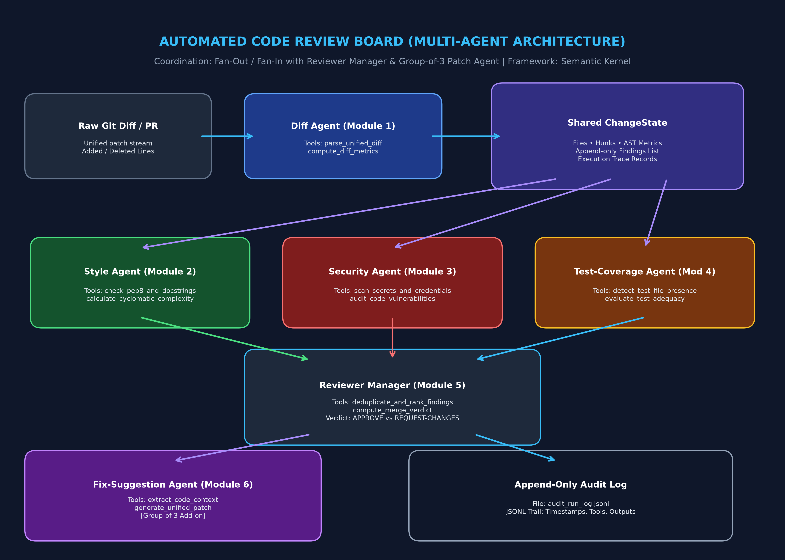

# Automated Code Review Board

**Course:** CSE476 — Agentic AI and Intelligent Automation  
**Academic Task:** Task 2 (Project 2) | Group 14  
**Framework:** Microsoft Semantic Kernel  
**Model Lane:** Groq (`openai/gpt-oss-120b`)  
**Coordination Architecture:** Fan-Out / Fan-In with Reviewer Manager & Group-of-3 Patch Add-On  

---

## 1. Agent Roster & Module Breakdown

The system decomposes automated pull request evaluation into specialized, single-responsibility agent modules:

| Agent Module | Primary Role | Mandatory Tools ($\ge 2$ Plain Python Functions) |
| :--- | :--- | :--- |
| **`DiffAgent`**<br>`agents/diff_agent.py` | Ingests unified diffs, extracts modified hunks, classifies file changes, and produces an executive change summary. | • `parse_unified_diff(raw_diff)`: Parses git diff headers, additions, and deletions.<br>• `compute_diff_metrics(files)`: Computes net churn, file distributions, and change footprint. |
| **`StyleAgent`**<br>`agents/style_agent.py` | Audits code for PEP 8 compliance, missing documentation, and excessive cyclomatic complexity. | • `check_pep8_and_docstrings(code_snippets)`: Audits line lengths, whitespace, and AST docstrings.<br>• `calculate_cyclomatic_complexity(code_snippets)`: Traverses AST decision points for complexity $> 8$. |
| **`SecurityAgent`**<br>`agents/security_agent.py` | Detects leaked credentials, API tokens, SQL injection, `eval`/`exec`, and command injection risks. | • `scan_secrets_and_credentials(diff_text)`: Regex scanner for AWS keys, tokens, and passwords.<br>• `audit_code_vulnerabilities(code_snippets)`: AST auditor for SQL injection, `shell=True`, and `pickle`. |
| **`TestCoverageAgent`**<br>`agents/test_coverage_agent.py` | Verifies whether changed logic is accompanied by unit tests and ensures new public functions are tested. | • `detect_test_file_presence(modified_files)`: Evaluates paired test files for modified code.<br>• `evaluate_test_adequacy(code, tests)`: Cross-references function signatures with test assertions. |
| **`ReviewerManagerAgent`**<br>`agents/reviewer_manager.py` | Fans in all specialist signals, deduplicates overlapping issues, ranks by severity, and issues the merge verdict. | • `deduplicate_and_rank_findings(findings)`: Deduplicates and prioritizes `CRITICAL` $\rightarrow$ `INFO`.<br>• `compute_merge_verdict(severity_counts)`: Evaluates policy gates to output `approve` or `request-changes`. |
| **`FixSuggestionAgent`**<br>`agents/fix_suggestion_agent.py`<br>*(Group-of-3 Add-on)* | Pinpoints the single highest-severity defect and generates a concrete unified patch (`.diff`) to resolve it. | • `extract_code_context(file_content, target_line)`: Pulls surrounding context for the flagged defect.<br>• `generate_unified_patch(path, orig, fix)`: Synthesizes a valid unified diff patch ready for `git apply`. |

---

## 2. Architecture & Why It Fits

The project applies a **Fan-Out / Fan-In with Reviewer Manager** architecture:
1. **Linear Diff Ingestion:** The `DiffAgent` parses the raw diff and initializes the shared state.
2. **Parallel Fan-Out:** Specialized analysis domains (Style, Security, Coverage) are inherently orthogonal. Running them concurrently via `asyncio.gather()` maximizes throughput and keeps agents decoupled.
3. **Fan-In Synthesis:** The `ReviewerManagerAgent` collects all findings, deduplicates redundant signals, ranks findings strictly by severity, and applies enterprise governance gates to adjudicate the merge recommendation.
4. **Group-of-3 Add-On:** When a merge is blocked, the `FixSuggestionAgent` automatically synthesizes a concrete code patch for the top finding, closing the feedback loop.



---

## 3. Shared State Model (`ChangeState`)

All agents read and update a unified, thread-safe Pydantic dataclass (`core/change_state.py`):
* **Diff Context:** `diff_id`, `raw_diff`, `files` (list of `TouchedFile` objects with additions/deletions), `summary`.
* **Shared Findings Blackboard:** An append-only list of `Finding` objects containing `id`, `agent`, `file_path`, `line_number`, `severity` (`CRITICAL`, `HIGH`, `MEDIUM`, `LOW`, `INFO`), `category`, `rule_id`, and `description`.
* **Adjudication Records:** `merge_verdict` (`approve` or `request-changes`), `verdict_rationale`, and `priority_findings`.
* **Patch Output:** `suggested_patch` and `patch_target_finding_id`.
* **Audit Trail:** Chronological execution events and warnings.

---

## 4. Honest Failure Handled

* **Failure Scenario:** **Malformed Syntax / Incomplete Diff Hunks (`SyntaxError` during AST Parsing)**
* **Real-world Context:** Pull request diffs often contain partial code snippets, incomplete statements, or syntax errors from unformatted draft commits. A naive static analysis tool crashes when calling `ast.parse()`.
* **Handling & Recovery Mechanism:**
  1. `tools/style_tools.py` and `tools/security_tools.py` catch `SyntaxError` within try-except guards.
  2. Rather than aborting the pipeline, the agent logs an explicit finding:  
     `STY-ERR-001 (HIGH): Failed to parse AST due to SyntaxError: ... Fallback token scanning applied.`
  3. The agent gracefully falls back to lexical regex scanning, appends the warning to `ChangeState.warnings`, and continues execution.
  4. The `ReviewerManagerAgent` includes the recovery notice in its executive summary without halting other agents.

---

## 5. Verification & Deliverables Guide

### Deliverables Checklist
* [x] **Source Code:** 6 distinct agent modules in `agents/`, 6 real tool modules in `tools/`, and core orchestrator in `core/`.
* [x] **Architecture Diagram:** Saved as `architecture_diagram.png` (generated by `generate_diagram.py`).
* [x] **Append-Only Run Log:** `logs/audit_run_log.jsonl` tracking events, tool calls, and decisions.
* [x] **Test File Covering 3 Scenarios:** `tests/test_scenarios.py` (clean code, critical security vulnerability, missing tests + honest failure).
* [x] **Runnable Demo Notebook:** `demo.ipynb` with pre-rendered execution traces across all three scenarios.

### How to Run

1. **Install Dependencies:**
   ```bash
   pip install -r requirements.txt
   ```

2. **Configure API Key:**
   Ensure `.env` contains your Groq credentials:
   ```env
   GROQ_API_KEY=gsk_...
   GROQ_MODEL=openai/gpt-oss-120b
   ```

3. **Execute Test Suite (All 3 Scenarios):**
   ```bash
   python -m pytest tests/test_scenarios.py -v
   ```

4. **Launch Demo Notebook:**
   ```bash
   jupyter notebook demo.ipynb
   ```
